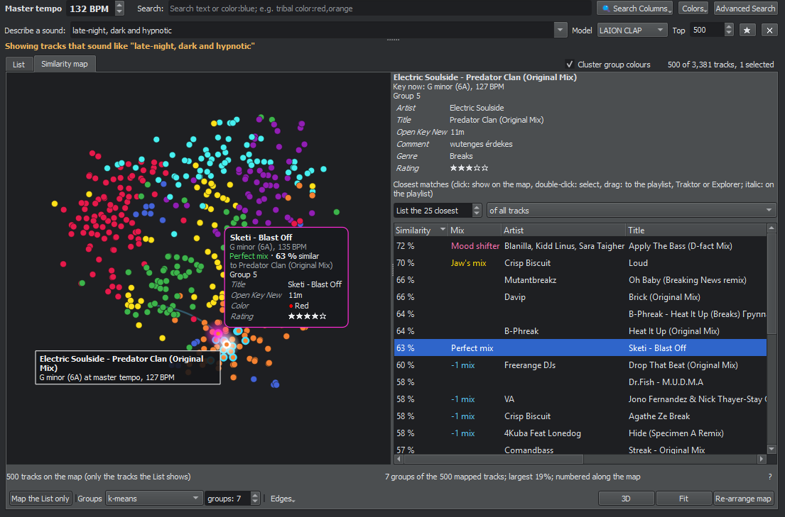

# SongSelector

[](https://github.com/csipapicsa/SongSelector/actions/workflows/ci.yml)
[](https://github.com/csipapicsa/SongSelector/releases/latest)
[](LICENSE)


[](https://csipapicsa.github.io/SongSelector/)

> **Using SongSelector?** The **[user guide](https://csipapicsa.github.io/SongSelector/)** walks you through it:
> [install](https://csipapicsa.github.io/SongSelector/getting-started/install/),
> [connect Traktor, Rekordbox or Mixxx](https://csipapicsa.github.io/SongSelector/dj-software/),
> everyday use and [troubleshooting](https://csipapicsa.github.io/SongSelector/troubleshooting/).
> This README is the technical overview. Wondering whether the exe is safe? See [SECURITY.md](SECURITY.md): what the app
> does and doesn't do, and how to verify a download (checksums, GitHub build provenance, VirusTotal).

A desktop app for Windows and Linux that helps DJs pick the next track. It sits next to Traktor, Rekordbox or
Mixxx, reads their libraries automatically, and answers three questions:

- **Will it mix in key at the tempo I'm playing?** With Key Lock off, speeding a track up raises its
  pitch. SongSelector shows every track's key *at the current master tempo*, in Musical, Camelot and
  Open Key notation, and recalculates the whole library as you change the master tempo.
- **What sounds like this track?** Neural audio models (MTG AllMusicCaps CLAP, LAION CLAP, PANNs CNN14, run
  through ONNX Runtime; on Windows on the GPU) turn every track into embeddings in the background. A similarity map
  and a closest-matches list then show tracks that *sound* alike, whatever their tags say.
- **Which of my tracks sound like *this*?** Type a description, *"funky breakbeat with a groovy bassline"*,
  and the CLAP models find the closest tracks in your library.



## Features

**Harmonic mixing**
- Tempo-adjusted key for every track: `semitones = round(12 · log2(target / original BPM))`
- Harmonic partners on the Camelot wheel (perfect, ±1, scale change, energy boost and four more mix
  types) as edges on the map and as a filter for the closest matches

**Audio similarity and free-text search**
- Three embedding models to choose from: MTG AllMusicCaps CLAP (trained on music; the default once downloaded;
  non-commercial) and LAION CLAP (sound *and* text in one space, 10 s windows), and CNN14 (sound similarity, 5 s
  windows). You pick which ones are analysed and which one
  the map uses; each track is decoded once for all of them, in a low-priority background process, on the
  GPU through DirectML (any DirectX 12 card) or on the CPU
- **Search by description:** a typed prompt is turned into a CLAP text vector and the closest tracks are
  listed; prompts can be saved, results dragged onto Traktor
- Similarity map (UMAP by default, or t-SNE or PCA; 2D or 3D; implemented in numpy to keep scikit-learn and numba
  out of the exe) with
  closest matches, drag and drop into Traktor's decks
- Unsupervised groups (k-means, neighbour communities, map density) as a sortable List column, numbered along
  the map (neighbouring groups get neighbouring numbers) and optionally as row colours (*Cluster group colours*)
- On the developer's library the map separated breakbeat and drum & bass with about 93 % purity,
  from audio alone

**Library integration, without export steps**
- Traktor: reads `collection.nml` (key, BPM, colour, rating, playlists) and re-reads it when Traktor saves;
  never writes to it. Traktor's **smartlists** work too: their queries are evaluated on Traktor's own data
- Rekordbox: reads playlists directly from its encrypted `master.db` (from a temporary copy);
  nothing to export, Rekordbox does not have to be closed
- Drag and drop MP3, WAV and FLAC files or whole folders; reads their tags, writes edited
  Artist / Title / Genre / Comment back to the file (in the background: the window does not freeze)

**Organising**
- Playlist panel for building a set in order; saved playlists and smartlists (stored search rules)
- Search by text, Traktor colour, own rating and colour; Advanced Search with numeric comparisons and the speed
  change (*within ± 8 %* of the master tempo)
- Own *Rating* and *Color* per track, independent of Traktor
- *Speed change* column: how much faster or slower each track plays at the master tempo (`+6.2%`)
- Cover art in the List, the Playlist and on the map (embedded, or `cover.jpg` / `folder.jpg` next to the file)
- *Delete duplicates*: same path, same Artist - Title or the same file in another folder, with a preview
- *View → Always on top* (above Traktor), dark and light theme

## Engineering

What is behind the features, and where to look:

| Area | What | Where |
|---|---|---|
| Architecture | Logic in `core/` (no widgets, unit-tested), PyQt5 UI in `ui/`. Embedding analysis in a separate process at low CPU and I/O priority, with crash recovery, so the UI and Traktor stay responsive | [docs/ARCHITECTURE.md](docs/ARCHITECTURE.md) |
| ML inference | Four models exported to ONNX, every one taking raw audio (LAION's spectrogram built into the graph); DirectML / CUDA / CPU chosen at runtime, batch sizes measured per model. Text encoders run in their own process with the `tokenizers` library, no PyTorch in the app | [core/embeddings.py](src/songselector/core/embeddings.py), [core/text_search.py](src/songselector/core/text_search.py), [research note](docs/research/text_search_clap.md) |
| Model choice by measurement | CPU and GPU cost of LAION vs Microsoft CLAP measured before any app work; a broken model (collapsed embeddings) caught and excluded | [docs/research/text_search_clap.md](docs/research/text_search_clap.md) |
| Model reproducibility | No model is in the repo; export scripts rebuild them from the published weights and check every export against PyTorch (and LAION's audio side against transformers' own feature extractor) | [Getting the models](#getting-the-embedding-models) |
| Testing | About 320 pytest tests, including headless Qt GUI tests and a test of the analysis process; acceptance tests on the developer's real library are marked and kept out of CI | [tests/](tests/) |
| Release verification | Every build (Windows exe, Linux AppImage) runs a self-check *inside the packaged app* (imports, GUI flows, Rekordbox reader, real inference) and a native-window smoke test (on Linux on Xvfb, closed through the X11 window protocol) before it is published | [selfcheck.py](src/songselector/selfcheck.py), [verify_release.ps1](scripts/verify_release.ps1), [verify_release.sh](scripts/verify_release.sh) |
| CI/CD | GitHub Actions: ruff, pytest on Windows and Linux, pip-audit, gitleaks over the full history, weekly scheduled run. `main` only accepts pull requests with green checks. A version tag builds, verifies and publishes the exe and the AppImage with SHA-256 checksums, signed build provenance (`gh attestation verify`) and VirusTotal reports ([SECURITY.md](SECURITY.md)) | [ci.yml](.github/workflows/ci.yml), [release.yml](.github/workflows/release.yml) |
| Research | Can the sound predict a DJ's own ratings and colours? Four embedding models (CNN14, MusiCNN, Discogs-EffNet, OpenL3) compared with artist-grouped validation and bootstrap intervals. The answer was mostly no (rating AUC ≈ 0.6 for all four), so the feature was put on hold rather than shipped | [docs/research/](docs/research/) |

## Install

Both downloads are in the [latest release](https://github.com/csipapicsa/SongSelector/releases/latest),
self-contained (no Python needed). Check them against `SHA256SUMS.txt` from the same release.

- **Windows:** `SongSelector-<version>.exe`. Put it in its own folder and start it. SmartScreen will warn because
  the exe is not code-signed.
- **Linux (x86_64):** `SongSelector-<version>-x86_64.AppImage`. Make it executable and start it:

  ```bash
  chmod +x SongSelector-*-x86_64.AppImage
  ./SongSelector-*-x86_64.AppImage
  ```

  Built on Ubuntu 22.04, so it runs on distributions from about 2022 on. It mounts itself with FUSE, which desktop
  distributions have; where FUSE is missing, start it with `--appimage-extract-and-run`. Analysis runs on the CPU.
  On Linux the app reads Mixxx's library (also Mixxx from Flathub); Traktor and Rekordbox do not run there.

The embedding models (similarity map, closest matches, groups, search by description) are a separate, optional
download (up to 2.3 GB): *Analysis → Get models…* → *Download* fetches them from Hugging Face and checks each file
([below](#getting-the-embedding-models)). Everything else works without them.

The app stores its data in one folder: on Windows **next to the exe**, on Linux in `~/.local/share/SongSelector`
(`$XDG_DATA_HOME/SongSelector`):

| File | Content |
|---|---|
| `SongSelector_settings.json` | Columns, search settings, tempo, colouring |
| `library.sqlite` | Every track loaded, your own ratings and colours, playlists and smartlists |
| `embeddings.sqlite` | CNN14 embeddings: a cache, safe to delete, rebuilt in the background |
| `embeddings-amc-clap.sqlite`, `embeddings-laion-clap.sqlite` | The same for the CLAP models (`embeddings-ms-clap.sqlite` from versions up to 1.5 is no longer used and can be deleted) |
| `models\` | The model files (next section) |

To upgrade, put the new exe in the same folder (Linux: replace the AppImage). Settings from versions before 1.1
(`SpotNextTrack_settings.json`) are taken over on the first start.

## Getting the embedding models

The model files are ONNX exports of published weights. They are not inside the app: *Analysis → Get models…*
downloads them from Hugging Face, one repo per model (below), each with a model card naming the source, the
changes and the licence. Downloads resume where they stopped, and each file's size and SHA-256 are checked before
use. The app downloads from a fixed commit of each repo, so what a version of the app gets never changes.

You can also build them yourself with the export scripts below (every export is checked against the original
PyTorch model), in a separate environment, since the exports need PyTorch and the app does not. By default the app
looks for them in the `models` folder next to its data (`.appdata\models\` when run from source); *Get models…* →
*Models folder…* (also in the *Analysis* menu) points it at any other folder, e.g. one that already holds the files
or is shared by several installations, and downloads go there too. To download from your own copy instead (a web folder serving the files under their names), set
`"Model download URL"` in `SongSelector_settings.json`.

| Model | Files | Download | Weights | Export |
|---|---|---|---|---|
| CNN14 | `cnn14.onnx` (327 MB) | [`csipapicsa/songselector-cnn14`](https://huggingface.co/csipapicsa/songselector-cnn14) | PANNs, Kong et al. 2020, [CC BY 4.0](https://zenodo.org/records/3987831) | `scripts\export_cnn14_onnx.py` (needs `torch panns-inference==0.1.1 onnx onnxruntime`) |
| LAION CLAP | `clap-laion-audio.onnx`, `clap-laion-text.onnx`, `clap-laion-tokenizer.json` (630 MB) | [`csipapicsa/songselector-clap-laion`](https://huggingface.co/csipapicsa/songselector-clap-laion) | [`laion/clap-htsat-unfused`](https://huggingface.co/laion/clap-htsat-unfused), Apache 2.0 | `scripts\export_clap_onnx.py --models laion` |
| AllMusicCaps CLAP (MTG) | `clap-amc-audio.onnx`, `clap-amc-text.onnx`, `clap-amc-tokenizer.json` (730 MB) | [`csipapicsa/songselector-clap-amc`](https://huggingface.co/csipapicsa/songselector-clap-amc) | [`mtg-upf/allmusiccaps_all_layers`](https://huggingface.co/mtg-upf/allmusiccaps_all_layers) by MTG (UPF), CC BY-NC-SA 4.0 (non-commercial) | `docs/research/experiments/clap/amclap_onnx.py export` (needs `amclap==0.1.0`) |

Microsoft CLAP ([`csipapicsa/songselector-clap-ms`](https://huggingface.co/csipapicsa/songselector-clap-ms), MS-PL) was offered up to
1.5; it is no longer, as it was the weakest for DJ music. Its repo and export (`--models ms`) stay for a later use.

To publish a new export: `scripts\publish_models.py --folder <folder>` checks the files against the app's list and
uploads them with the model cards (`packaging/models/hf/`); then put the printed commits into
`src/songselector/core/model_download.py`.

```powershell
py -3.12 -m venv .export-venv
.\.export-venv\Scripts\python -m pip install "torch>=2.6" panns-inference==0.1.1 msclap==1.3.4 onnx onnxruntime
.\.export-venv\Scripts\python scripts\export_cnn14_onnx.py
.\.export-venv\Scripts\python scripts\export_clap_onnx.py
```

Then switch the models on under *Analysis → Embedding models*. Each track is decoded once for all of
them. Speed for a 6-minute track on a GTX 1650 Ti (DirectML): CNN14 0.6 s, LAION CLAP about 2.2 s,
AllMusicCaps CLAP about 0.9 s, plus 0.8 s decoding; on the CPU several times that. After the first pass
only new or changed files are analysed. *Analysis → Analyse embeddings in background* pauses it.

## Using it

### Similarity map

The *Similarity map* tab (Ctrl+2; Ctrl+1 for the List) shows the analysed tracks of the List as it is
filtered now, so narrow the List first to explore one style.

| Action | Result |
|---|---|
| Hover / click a dot | Details; a click also lists its 15 most similar tracks (cyan rings). What the hover card, the selected track's label and the details panel show: *View → Map track details…* |
| Right-click beside the map | Show or hide the selected track's details above the closest matches (also *View → Selected track details*) |
| Shift+right-drag (2D) | Turn the map left or right about the middle of the view |
| Shift+drag (3D) | Rotate the 3D view |
| Double-click in the matches list | Select that track and show its own matches |
| Drag a dot or a match | The files, e.g. onto a Traktor deck or playlist |
| Drop a track on the map | Select it and show its closest matches |
| Double-click a dot | Add to the playlist |
| Scroll / drag | Zoom / move (anywhere, even out of view; *Fit* brings the map back) |
| *Edges* menu | Lines to harmonic partners (tempo-adjusted keys), same colour or same rating, optionally only to the N most similar |
| *Groups* | Colour dots by unsupervised groups (numbered along the map) |
| Ctrl+click a dot | Compare it with the selected track (card, mix type, similarity); Ctrl+click it again or on empty space to stop |
| Esc | First stops the comparison, then clears the selection |
| *Closest matches* | *all*; *harmonic only* (plus tracks without a key); or *Edges selection*: only the relations checked under *Edges* |
| Select tracks in the Playlist | Shown on the map with an amber ring, even if the List filters them out (dashed) |
| *Map the List only* | Map and group just the tracks the List shows; follows the List as it changes |
| *Layout* | t-SNE (tight clumps, most neighbours kept), UMAP (seconds instead of minutes) or PCA (instant, large-scale distances) |
| *Re-arrange map* | Recompute the layout (a few minutes for 3,000 tracks with t-SNE) |

The map's buttons (*Map the List only*, *Groups*, *Edges*, *Layout*, *3D*, *Fit*, *Re-arrange map*) are below the map.
Distances on a 2D map are approximate; the closest-matches list uses the full embeddings.

*View → Search bars* (or dragging the line under them up, as the Playlist and Browser fold away on the left)
hides the *Master tempo*, *Search* and *Describe a sound* rows above the List; a search set before stays in force.

### Search by description and choosing models

The **Describe a sound:** bar above the List is the quickest way: type, in your own words, what a track should
sound like (or pick a saved prompt from its dropdown) and press Enter. The List then shows the closest tracks of
the chosen CLAP model, best first in the `#` column, with their similarity to the description in *Match* (cosine similarity as a
percentage, higher is closer; compare within one search). ★ saves the prompt, ✕ deletes it, and *Top* changes how
many tracks are shown without searching again (*All* lists every analysed track). *No search: show all
tracks* at the top of the dropdown (or Enter in an empty field) goes back; Browser → *All Tracks* shows all tracks.
The *Model* box next to it is the one model choice: it sets the model of the search and of the similarity map,
closest matches and groups (CNN14 can drive the map but has no text side, so it cannot search by description).
Choosing a model that has not analysed the whole library yet switches it on and analyses the rest in the background.
With a playlist, smartlist or other Browser entry shown, the search ranks only its tracks.
*Analysis → Search by description…* (Ctrl+Shift+F) opens the same search in its own window, with scores.
Describe the sound (instruments, textures, energy, mood: *"warm pads, slow and dreamy"*, *"distorted
acid line, hypnotic"*); *"This audio is a drum and bass song."* style sentences also work well. Save
prompts you want to repeat, double-click a result to select it in the List, drag results onto Traktor.
Only tracks already analysed with that model can be found.

*Analysis → Embedding models* sets which models are kept up to date (each shows how many tracks it has
analysed); *Similarity model* (the same as the *Model* box) sets which one the
map, the closest matches and the groups use. Each model keeps its own map layout. *Parallel analysis* sets how
many tracks are analysed at once (automatic: 2 on a GPU). On laptops with two GPUs the analysis uses the
high-performance one, and each model's batch size is measured once on your machine.

### Playlists and smartlists

- **Playlist** tab: the set being built, in order. Drag rows to reorder; *Save as Playlist...* keeps a copy.
- **Browser** tab: *Track Collection* (All Tracks, Artists, Albums, Genres), your playlists, and
  **Traktor Playlists** / **Rekordbox Playlists** (read-only, kept up to date). Click an entry to
  filter the List, double-click to load it into the Playlist tab.
- A **smartlist** stores search rules, not tracks; it always shows what matches now.
- **Traktor smartlists** are evaluated on Traktor's own data (BPM, colour, rating, genre, comment, key, length,
  play count, import date...). Two assumptions, as Traktor does not store them: `~` means within 1 BPM, and `&`
  binds tighter than `|`. A smartlist on *played in this session* cannot be evaluated outside Traktor; the bar above
  the List says so. Rekordbox smartlists are listed but not evaluated yet.

### Search syntax

| Search bar | Matches |
|---|---|
| `tribal` | Text in the columns ticked under *Search Columns* |
| `color:blue`, `color:red,orange`, `-color:blue`, `color:none` | Traktor colour |
| `sscolor:blue`, `-sscolor:none` | Your own colour |

*Advanced Search* adds numeric comparisons (e.g. own rating at least 4) and, on *Speed change*, *within ± (%)* /
*outside ± (%)*: e.g. tracks that play at most 8 % faster or slower at the master tempo (it follows the tempo
slider). Setting a row's column to *None* switches that row off without losing it.

### List view

| Setting | How |
|---|---|
| Cover art | *View → Cover art*: off, cropped to the row height, or square rows; 48 / 72 / 96 px |
| Always on top | *View → Always on top*: SongSelector stays above other windows |
| Columns | Right-click a column header: show or hide columns (*Speed change*, *Match*, *Group*, *Cover*...) |
| Sorting by *Group* | Within each group, the best *Match* of a description search comes first |

### Configuration

| Setting | How |
|---|---|
| Traktor collection | Auto-detected under `Documents\Native Instruments\Traktor*\`. Change via *Import → Link Traktor collection…* |
| Rekordbox library | Auto-detected from Rekordbox's settings, else `%APPDATA%\Pioneer\rekordbox\master.db`. Change via *Import → Link Rekordbox library…* |
| Mixxx library | Auto-detected: `~/.mixxx` on Linux (Flatpak: `~/.var/app/org.mixxx.Mixxx/.mixxx`), `%LOCALAPPDATA%\Mixxx` on Windows. Change via *Import → Link Mixxx library…*. Mixxx can stay open; nothing is written to it |
| Primary DJ program | *Import → Primary DJ program*: when Traktor and Mixxx both know a track, its key, BPM, colour and rating come from this one; the other fills gaps |
| Data folder | `SONGSELECTOR_APP_DATA_DIR` environment variable |

## Development

Requirements: Windows, Python 3.11 (64-bit) available as `py -3.11`.

```powershell
.\scripts\setup.ps1                  # create .venv, install pinned dependencies
.\.venv\Scripts\Activate.ps1
python -m songselector               # run from source; data goes to .appdata\ (git-ignored)
.\scripts\test.ps1                   # pytest; pass options through, e.g. -k color
python -m ruff check src tests       # lint
.\scripts\build.ps1                  # -> dist\SongSelector-<version>.exe
.\scripts\verify_release.ps1         # self-check inside the exe + native window test
                                     # add -Model <path>\cnn14.onnx to include GPU inference
```

On Linux (Python 3.11; on Ubuntu also Qt's xcb libraries, see the `apt-get` line in
[ci.yml](.github/workflows/ci.yml)):

```bash
python3.11 -m venv .venv && .venv/bin/pip install -r requirements-dev.txt
.venv/bin/python -m songselector     # run from source
.venv/bin/python -m pytest           # tests
scripts/build_linux.sh               # -> dist/SongSelector-<version>-x86_64.AppImage
xvfb-run -a scripts/verify_release.sh  # self-check inside the AppImage + window test on a virtual display
```

Set `SONGSELECTOR_CNN14_ONNX` to `cnn14.onnx`, and `SONGSELECTOR_CLAP_MODELS` to the folder with the CLAP
files, to also run the real-model tests.

**User guide** ([csipapicsa.github.io/SongSelector](https://csipapicsa.github.io/SongSelector/)): MkDocs Material,
pages in `userdocs/` (not `docs/`, which holds worklogs and research). A change users can see updates its page in
the same pull request. Preview with `python -m pip install -r requirements-docs.txt` then
`python -m mkdocs serve` (http://127.0.0.1:8000). [docs.yml](.github/workflows/docs.yml) builds it with `--strict`
on pull requests and publishes it to GitHub Pages from `main`.

**Releases** are built by GitHub Actions: bump `__version__` in
[src/songselector/\_\_init\_\_.py](src/songselector/__init__.py) and rename the changelog's
`[Unreleased]` section in a pull request, merge it, then tag the merge commit (`git tag vX.Y.Z`,
`git push origin vX.Y.Z`). The workflow checks that the tag matches the code and is on `main`, runs
the tests on both systems, builds and verifies the exe and the AppImage and publishes them with their
checksums and the changelog section as notes. Pull requests that change the packaging run the same build as a dry run.

```text
src/songselector/
    app.py         Entry point
    config.py      Constants, column layout, app-data location
    env.py         Environment variables
    selfcheck.py   End-to-end check that runs inside the packaged exe
    core/          Logic without widgets: keys, tags, Traktor/Rekordbox readers, embeddings, similarity
    ui/            PyQt5 main window, similarity map, dialogs
tests/             pytest suite
packaging/         PyInstaller spec and launcher
scripts/           setup / test / build / verify / model export
docs/              Architecture, backlog, research notes, daily worklogs
userdocs/          User guide (MkDocs, published to GitHub Pages)
```

More: [CHANGELOG.md](CHANGELOG.md), [docs/BACKLOG.md](docs/BACKLOG.md) (known issues and plans),
[docs/worklogs/](docs/worklogs/) (what was done each day, and why).

## License

GPL-3.0 (PyQt5 and other bundled libraries are GPL, so the exe is too). The CNN14 weights are by
Kong et al., [PANNs](https://github.com/qiuqiangkong/audioset_tagging_cnn), CC BY 4.0.
