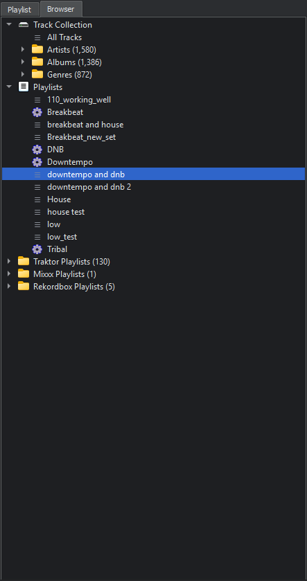

# Connect your DJ software

SongSelector reads your DJ software's own library files directly. There is **nothing to export**, and you do not
have to close your DJ software. When it saves, SongSelector picks up the changes by itself.

| | Traktor | Rekordbox | Mixxx |
|---|---|---|---|
| Found automatically | Yes | Yes | Yes |
| Key, BPM, colour, rating | Yes | Not yet | Yes |
| Playlists in the Browser | Yes | Yes | Yes (also crates and history) |
| Smartlists | Yes, evaluated | Listed, not evaluated yet | — |
| Can stay open | Yes | Yes | Yes |
| Writes to its library | **Never** | **Never** | **Never** |
| Windows / Linux | Windows | Windows | Both |

## How it fits together

1. You [add your music](../getting-started/first-start.md#1-add-your-music) to SongSelector.
2. For each track your DJ software also knows, SongSelector takes its **key, BPM, colour and rating**: the values
   you curated there, not a second analysis.
3. Your DJ software's **playlists** appear in the **Browser** tab, read-only and kept up to date.

<figure markdown="span">
  { width="300" }
  <figcaption>The Browser tab: your own playlists and smartlists, and below them the playlists from Traktor, Mixxx and Rekordbox.</figcaption>
</figure>

## If more than one program knows a track

**Import → Primary DJ program** decides whose values win when Traktor and Mixxx both know a track: the primary
program's key, BPM, colour and rating are used, and the other only fills what is empty. By default it is the first
program found (Traktor, then Mixxx).

## Pick your program

- [Traktor](traktor.md)
- [Rekordbox](rekordbox.md)
- [Mixxx](mixxx.md)
