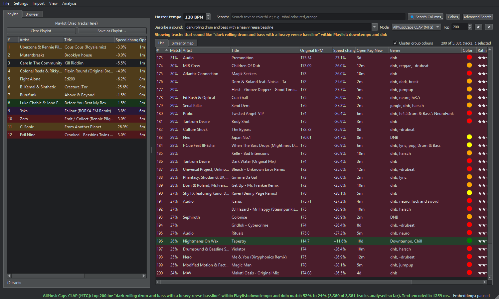

# Search by description

Type what a track should sound like and get the closest tracks in your library. Needs a **CLAP** model
([Getting the models](models.md)); only tracks that model has already analysed can be found.

## How

1. Type into **Describe a sound** above the List, for example *"warm pads, slow and dreamy"*, and press Enter.
2. The List shows the closest tracks, best first in the `#` column. *Match* shows how close each one is (higher is
   closer; compare within one search).

<figure markdown="span">
  
  <figcaption>"dark rolling drum and bass with a heavy reese bassline" with AllMusicCaps CLAP, searched within one playlist: best matches first, with their <em>Match</em> score.</figcaption>
</figure>

| Control | Does |
|---|---|
| ★ | Save the description to reuse it from the dropdown |
| ✕ | Delete a saved description |
| *Top* | How many tracks to show (*All* lists every analysed track) |
| *Model* | Which CLAP model searches (also drives the map) |
| *No search: show all tracks* | Back to the normal List (or Enter in an empty field) |

With a playlist or other Browser entry shown, only its tracks are ranked.

To keep only the close matches, add an [Advanced Search](../using/search.md#advanced-search) rule on *Match*, for
example *Match at least 30*, with *Top* set to *All*. On the [similarity map](similarity-map.md) the dots are sized by
their *Match*: the best match is the biggest dot.

**Analysis → Search by description…** (++ctrl+shift+f++) opens the same search in its own window.

## Writing good descriptions

Describe the **sound**: instruments, textures, energy, mood.

- *"distorted acid line, hypnotic"*
- *"funky breakbeat with a groovy bassline"*
- *"This audio is a drum and bass song."* Plain sentences like this work well too.

Results differ between the two CLAP models, so if one misses, try the other.
