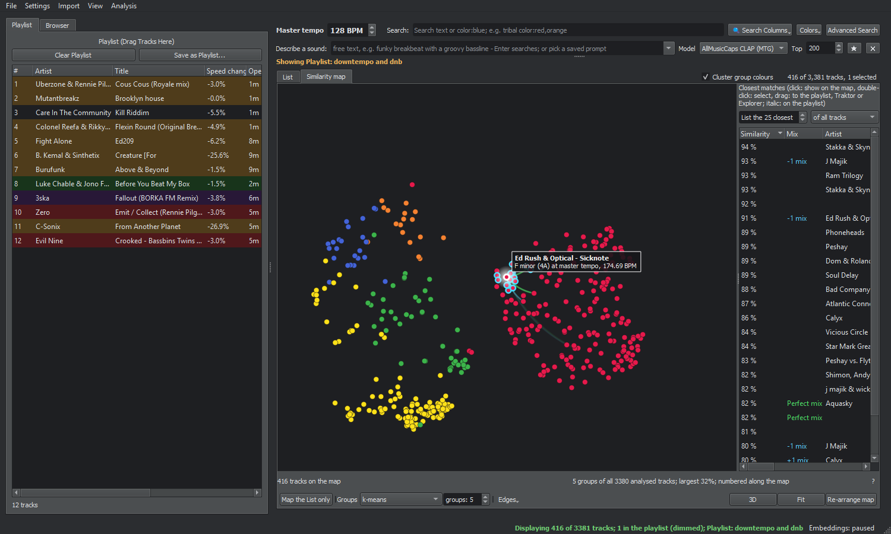
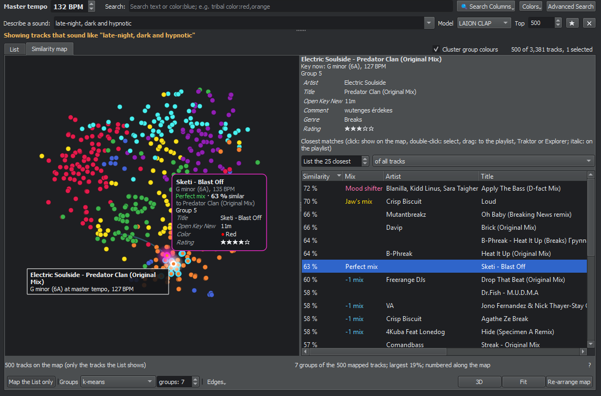

# Similarity map

The **Similarity map** tab (++ctrl+2++) places every analysed track on a map: tracks that sound alike end up close
together. It maps the List as it is filtered now, so narrow the List first to explore one style.

<figure markdown="span">
  
  <figcaption>One playlist (416 tracks) on the map, coloured by group. The selected track's closest matches have cyan rings and are listed on the right; lines go to harmonic partners.</figcaption>
</figure>

## Exploring

| Do | Get |
|---|---|
| Hover or click a dot | Its details; a click also lists its 15 most similar tracks (cyan rings) |
| Double-click in the matches list | Jump to that track and show *its* matches |
| Double-click a dot | Add it to the Playlist |
| Drag a dot or a match | The file, onto a Traktor deck or playlist |
| Drop a track on the map | Select it and show its closest matches |
| ++ctrl++ + click a dot | Compare it with the selected track (mix type, similarity); again to stop |
| Scroll / drag | Zoom / move; *Fit* brings the map back |
| ++esc++ | Stop comparing, then clear the selection |

### Comparing two tracks

Select a track, then ++ctrl++ + click another dot: a card shows how they mix (here a *perfect mix*, both in G minor
at the master tempo) and how similar they sound. The panel above the closest matches shows the selected track's
details (right-click beside the map, or *View → Selected track details*).

<figure markdown="span">
  
  <figcaption>The map after a description search: the selected track's details on the right, a compared track's card on the map.</figcaption>
</figure>

## The buttons below the map

| Button | Does |
|---|---|
| *Map the List only* | Map just what the List shows, and follow it as it changes |
| *Groups* | Colour dots by sound groups the app finds by itself |
| *Edges* | Lines to harmonic partners (keys at the master tempo), same colour or same rating |
| *3D* | A 3D map (++shift++ + drag rotates) |
| *Re-arrange map* | Compute the layout again (a few minutes for 3,000 tracks) |

*Closest matches* can show *all* similar tracks, *harmonic only*, or only the relations ticked under *Edges*.

!!! note
    Distances on a 2D map are approximate. The closest-matches list uses the full model output, so trust it over
    what looks close on the map.

Which model drives the map is set by the **Model** box next to *Describe a sound*; each model keeps its own map.
