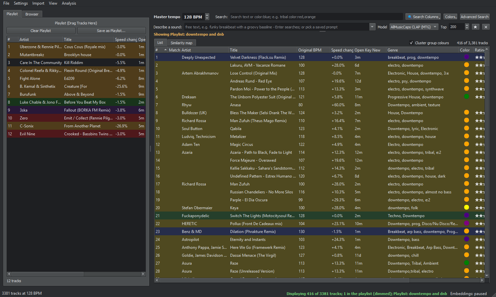

# Keys at the master tempo

## Why the key changes: think vinyl

On a turntable, the pitch fader changes how fast the platter spins. Play a record faster and everything on it goes
up in pitch: drums, bass, vocals. It's the same effect as playing a 33 rpm record at 45. Speeding up by about **6 %**
raises the music by **one semitone**, and so the track lands in a **different key**.

DJ software does the same thing whenever **Key Lock is off**: changing the tempo changes the key, as on vinyl.
SongSelector works out each track's key **at the tempo you're playing**, so you can mix in key without doing the maths
in your head.

!!! warning "Turn Key Lock off in your DJ software"
    These numbers assume the deck plays like a turntable, with the key following the tempo.

    | Program | The setting | Should be |
    |---|---|---|
    | Traktor | *Key Lock* (the **KEY** button on the deck) | Off |
    | Rekordbox | *Master Tempo* (the **MT** button on the deck) | Off |
    | Mixxx | *Key lock* (the lock button on the deck) | Off |

    With Key Lock **on**, the software keeps the original key at any tempo. Then use the *Original Key* column and
    ignore the "new" keys.

### An example

A track at **120 BPM in 8A** (A minor), played at a master tempo of **127 BPM**:

- 127 / 120 = 5.8 % faster, which is one semitone up: `round(12 × log2(127 / 120)) = 1`.
- A minor one semitone up is A♯ minor (also written B♭ minor), which is **3A** on the Camelot wheel.

So at 127 BPM this track mixes with 3A tracks, not 8A tracks. SongSelector shows 3A.

## Set the master tempo

Type the tempo you're playing at into **Master tempo** above the List. Every key and speed column follows it
straight away.

<figure markdown="span">
  
  <figcaption>Master tempo 128 BPM: <em>Speed change</em> shows how far each track has to be pitched, <em>Open Key New</em> its key at that speed.</figcaption>
</figure>

## The columns

| Column | Meaning |
|---|---|
| *Original BPM*, *Original Key* | The track as it is, from your DJ software or the file's tags |
| *Speed change* | How much faster (+) or slower (−) the track plays at the master tempo, as on the pitch fader (`+5.8%`) |
| *New Key* | The key at the master tempo, in musical notation (A#) |
| *Camelot Key New* | The same in Camelot notation (3A) |
| *Open Key New* | The same in Open Key notation, as in Traktor (8m) |

Right-click a column header to show or hide columns.

## Harmonic mixing: which keys go together

SongSelector uses the standard harmonic mixing rules on the **Camelot wheel** (Mixed In Key's harmonic mixing
table). The wheel puts the 24 keys on a clock: numbers 1–12 around it, **A** for minor keys and **B** for major
keys. Neighbours on the wheel share most of their notes, so they blend without clashing.

From a track in **8A**, these are the moves, safest first:

| Move | Example from 8A | What it sounds like |
|---|---|---|
| Perfect mix | 8A → 8A | Same key: always safe |
| +1 mix | 8A → 9A | One step clockwise: smooth, lifts slightly |
| −1 mix | 8A → 7A | One step back: smooth, calms slightly |
| Scale change | 8A → 8B | Minor to major (or back) on the same number: changes the mood |
| Energy boost | 8A → 10A | Two steps up: a noticeable lift |
| Mood shifter | 8A → 11B | Minor to major, three steps: a special effect, use with care |
| Jaw's mix | 8A → 3A | Seven steps (a semitone up): a special effect, use with care |
| Diagonal mix | 8A → 7B | Across and back one step |
| G jump sharp | 8A → 5A or 11A | Our own move, not Mixed In Key's: minor to minor, three semitones up or down (Am ↔ Cm, Am ↔ F#m) |

Moves are one-way: 8A → 10A is an energy boost, but 10A → 8A isn't a named move. (G jump sharp works both ways.)

## Finding what mixes in key

- On the [similarity map](../sound/similarity-map.md), *Edges* draws lines to these harmonic partners, using the keys
  at the master tempo.
- *Closest matches → harmonic only* lists only the similar-sounding tracks that also mix in key.
- *Advanced Search* on *Speed change* finds tracks you can reach without pushing the pitch fader too far, for example
  *within ± 8 %* of the master tempo. See [Searching](search.md).
