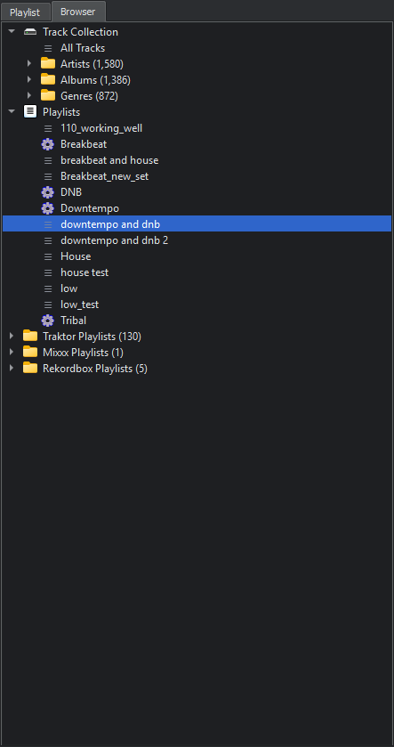

# Playlists and smartlists

## The Playlist tab: building a set

The **Playlist** tab on the left is the set you are building, **in order**.

- Double-click a track in the List, or drag it over, to add it.
- Drag rows to reorder.
- **Save as Playlist…** keeps a copy under *Playlists* in the Browser.

Tracks on the playlist stay in the List, dimmed and in italics, so a search still finds them.
*View → Hide playlist tracks in the library* hides them instead.

## The Browser tab

| Section | What it holds |
|---|---|
| *Track Collection* | All Tracks, Artists, Albums, Genres |
| *Playlists* | Your saved playlists and smartlists |
| *Traktor Playlists*, *Rekordbox Playlists*, *Mixxx Playlists* | From your DJ software: read-only, kept up to date |

Click an entry to show it in the List; double-click to load it into the Playlist tab.

<figure markdown="span">
  { width="300" }
  <figcaption>Your playlists (≡) and smartlists (⚙), then the folders from your DJ software.</figcaption>
</figure>

## Smartlists

A smartlist stores **search rules**, not tracks, so it always shows what matches now. Save one from the
Advanced Search settings.

Traktor's own smartlists work too; see [Traktor](../dj-software/traktor.md).
